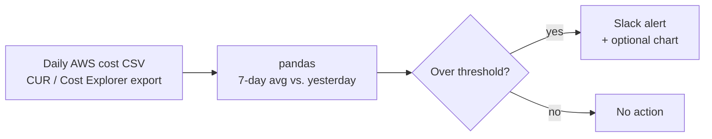

# Cost Spike Alert Bot: AWS Spend Alerts in Slack

-FF6C37?style=flat-square)

A lightweight Python bot that compares yesterday's AWS spend to the trailing 7-day average and posts a Slack alert when the jump crosses a threshold, so nobody has to keep checking Cost Explorer.

📄 **Case study:** [Cost Spike Alert Bot: Real-Time AWS Alerts in Slack](https://iamnicolecoleman.com/portfolio/case-study-finops-spike-alert-bot-real-time-cost-surge-detection/)

## Skills demonstrated

| Skill | Where it shows up |
|---|---|
| API integration | Posting alerts to Slack through its Web API with a bot token (`requests`) |
| Secrets handling | Token loaded from a `.env` file with `python-dotenv`, kept out of Git |
| Data processing | Parsing daily cost exports and computing the 7-day baseline (pandas) |
| Alert logic | Configurable percentage threshold for what counts as a spike |
| Visualization | Optional comparison chart generated with Matplotlib |

## How it works

## Files

| File | Description |
|---|---|
| `finops_spike_alert.ipynb` | Main notebook: load data, detect spikes, send the alert |
| `dummy_aws_cost_data.csv` | Sample cost data for testing |
| `cost_comparison_chart.png` | Example chart output |

## Setup

1. Clone the repo.
2. Create a `.env` file in the root with your Slack bot token (never commit it).
3. Open `finops_spike_alert.ipynb` and run the cells.

## What I'd add next

- Scheduled daily runs (GitHub Actions or AWS Lambda)
- Multi-account aggregation
- Rolling-window or z-score detection to cut false positives

---

**Nicole Coleman** · Founder, 3509 Innovations · [LinkedIn](https://www.linkedin.com/in/nicoledcoleman/) · [Portfolio](https://iamnicolecoleman.com)
